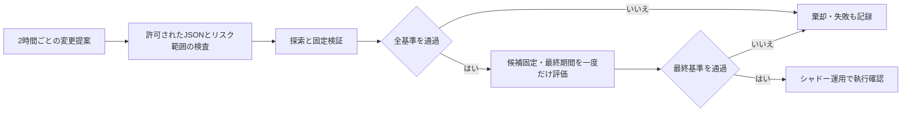

# AI暗号資産トレーダー研究の追補：採用審査・ペア取引・ウォレット情報

調査日：2026年11月13日。対象は10月23〜30日号と、10月30日〜11月6日号。前者は保存済みの検証結果を再点検し、後者は一次論文・公開実装を確認した。新しい論文の売買成績を再現したとはしていない。

**最も取り入れる価値があるのは、戦略変更の採用審査である。利益の出る売買方策が見つかったとは結論できない。** 次に参考になるのが、RLの外側でサイズ・損切り・証拠金余裕を制限する設計。ウォレット情報は短期の執行判断に使う候補であり、現在の5分周期のLLMへそのまま追加できる根拠はない。

## 1. 今回の3研究の位置づけ

| 研究 | 確認できたこと | 実用に向けた判断 |
|---|---|---|
| Hard to Fool | 最終評価で好成績候補を棄却する設計と、その公開参考コード | 採用審査の設計を優先。収益性の証明にはしない |
| Dynamic Multi-Pair Trading v3 | 5seedのばらつき、コスト感度、外側のリスク制御 | 構造は参考になるが、平均CAGRを期待収益として使えない |
| Beyond Anonymous Order Flow | ウォレット特徴量による秒単位の予測精度改善 | 受信時刻付きデータで別途執行実験が必要 |

### Hard to Fool：棄却理由と公開範囲を正確に読む

QQQ候補の探索・検証・最終評価のSharpeは著者報告で2.94／3.34／0.26、取引数は221／43／72だった。重要な補足は、**最終評価でも純利益は正で、コスト倍増にも耐えたが、期間を二分すると一方が赤字になり棄却された**こと。Sharpeが0.26になったこと自体が単独の棄却基準ではない。[原論文§3.1・表2](https://arxiv.org/html/2611.06607v1#S3.SS1)

公開コードでは、提案のJSON語彙、評価期間、費用、試行予算を固定し、探索終了後に最大3候補を確定する。検証時のbootstrap下側確率は0.05÷候補数。週単位で2,000回再標本化し、損益・不確実性・高コスト耐性・標本数・期間別安定性をそれぞれ判定する。比較対象が弱く、それに勝っただけの候補は採用しない。[固定版評価器](https://github.com/henryzhangpku/autonomous-quant-researcher/blob/69630f47fa7009f481b10af53c51fc91681babdf/research/v3/evaluator.py)

最終評価は、使用済みの記録を永続化してからデータを読み、途中で失敗しても再試行を拒否する実装を確認した。ただし、ローカル保存領域全体の巻き戻しまで防ぐ外部公証ではない。また、同じデータを別キャンペーン名で再利用することや、人が結果を覚えたまま仮説を変更することを含め、全探索の偽陽性率を保証する仕組みでもない。これは公開コードの保証範囲からの判断である。[状態管理と台帳](https://github.com/henryzhangpku/autonomous-quant-researcher/blob/69630f47fa7009f481b10af53c51fc91681babdf/research/v3/campaign.py)

**公開版は参考実装であり、実運用の研究エンジンは非公開**とREADMEに明記されている。今回は11月10日のcommit `69630f4`を確認したため、11月6日時点の公開コードと同一とは扱わない。全キャンペーンの独立再現は実施していない。[固定版README](https://github.com/henryzhangpku/autonomous-quant-researcher/blob/69630f47fa7009f481b10af53c51fc91681babdf/README.md)

Hyperliquidへの適用案は、2時間ごとに提案を受け付けても、採用時期は十分な検証データが揃うまで待つ構成である。「レビュー間隔2時間」と「2時間ごとに本番戦略を変えること」を同一視しない。オプション固有のedge計算や標本数をPerpへそのまま転用せず、実Funding、遅延、費用、現行戦略との差分損益に置き換えて事前固定する。

### Dynamic Multi-Pair Trading：平均値より検定対象が重要

現行v3は10月31日改訂。1時間足、2024年学習・2025年評価の研究で、学習1倍・評価10倍という条件がある。v3はseedのばらつきを強調している。ただし「5%水準に届かない」こと自体はv2にも書かれており、v3で初めて開示されたわけではない。[版履歴](https://arxiv.org/abs/2606.04574)・[v3本文](https://arxiv.org/html/2606.04574v3)

| seed | 著者報告CAGR | 最大DD |
|---|---:|---:|
| 0 | 33.46% | 42.50% |
| 1 | 48.69% | 47.95% |
| 42 | 199.45% | 35.27% |
| 100 | −3.00% | 42.48% |
| 999 | 43.20% | 59.11% |

表を再集計すると、平均64.36%に対して中央値は**43.20%**、最高seedを除く平均は**30.59%**。基準戦略のCAGRは30.40%だった。ただし、この除外平均は影響の大きさを見る記述値であり、別の優位性検定ではない。

**p＝0.0603は5seed平均の検定ではなく、seed42と基準戦略のSharpe比較**である。95%区間はゼロを含み、事後的な多数の比較への補正もない。片道0／5／10bpでCAGRが446.83／199.45／63.29%となるコスト試験もseed42の結果であり、全seedが耐えた証拠ではない。[v3の頑健性・コスト分析](https://arxiv.org/html/2606.04574v3)

公開コードの「年率Sharpe」は `(CAGR − 無リスク金利) / 年率volatility` で、一般的な算術平均の超過収益を使うSharpeとは定義が異なる。他研究や前回のBinance実験と数値を直接比較しない。[指標実装](https://github.com/damianlebiedz/pair-trading-with-rl/blob/2caba40a838dbc8f7cba02348b483913b7b32821/modules/performance/stats.py)

Funding、実際のスプレッド、部分約定、遅延を含む再検証が残る。10bp条件は追加5bpをスリッページの代わりにしたもので、板を再現したわけではない。清算も維持証拠金ではなく割当証拠金の全損に近い判定。公開repoの確認commit `2caba40` は6月17日で、v3との厳密な対応は未確認である。[公式README](https://github.com/damianlebiedz/pair-trading-with-rl/blob/2caba40a838dbc8f7cba02348b483913b7b32821/README.md)

保存モデルなどの[Zenodo成果物](https://zenodo.org/records/20355140)は実在し、results.zip約3.03GB、data.zip約1.57GB。今回この約4.60GBは取得せず、著者の5seed学習を再実行していない。コードの利用条件は研究・教育用途に限られ、商用システムへそのまま移植する際は許諾の確認が必要である。設計を参考にすることと、コードの商用転用は区別する。

### Beyond Anonymous Order Flow：R²の改善は売買利益ではない

ウォレット選別は7月1〜10日、学習11〜20日、評価21〜27日。Ridgeの10.88%→12.31%は、BTC・ETH・SOLの100msグリッドをまとめた**1秒先予測のR²**であり、増分は1.43ポイント、相対13.2%。利益率ではない。木モデルでも19.48%→20.65%と改善するが、相対改善は約6.0%に小さくなる。[原論文](https://arxiv.org/html/2611.05218v1)

上位ウォレット群、特徴量のスケール、評価終了日の選び方には事後判断が残る。300msずらす検査は、実際にその時刻に受信できた証明ではない。古い状態の持ち越しを全区間で除外する検査も未完了。記述的なmarkoutには5分先までの図がある一方、**5分予測と費用控除後の売買成績は未検証**という読み方が正確である。[方法・限界](https://arxiv.org/html/2611.05218v1)

本体の完全な公開実装と2026年7月の著者収集データの配布リンクは確認できなかった。ただし補助検証に参照する2025年12月の[公開Hyperliquidデータ](https://doi.org/10.5281/zenodo.18184441)はあるため、「関連データがすべて非公開」とも言えない。

BinanceのOHLCVだけではウォレット別注文フローは再現できない。応用するなら、同じ売買シグナルを固定し、「通常執行」と「短時間待機」を受信時刻付きデータで比較する。markoutだけでなく、待機中の機会損失、未約定率、約定価格、手数料、急変時の損失も見る必要がある。公開アドレスの事後ランキングをそのまま追随売買へ使う段階ではない。

## 2. 手元のBinance結果に採用審査を当てるとどうなるか

前回の成功済みバックテストは再実行せず、保存済み39成果物のハッシュ一致を確認したうえで、22方式の既存結果を再集計した。期間は2026年1〜9月、基準費用は片道手数料5bp＋スリッページ1bp、増額条件は5bp＋5bp。実Fundingは元の計算に含まれる。

今回の審査例は「純損益が正」「週クラスタbootstrapの下限が正」「増額費用でも純損益が正」「期間前半・後半の双方が正」の4条件とした。週単位で10,000回再標本化し、初期資金で正規化した日次金額損益の5%分位を確認する。元論文の取引単位オプション評価器の再現ではない。

| 既存方式 | 基準費用の純収益 | 増額費用の純収益 | 週クラスタ下限が正 | 4条件の合格 |
|---|---:|---:|---|---|
| RL・費用＋リスク罰則10 | ＋0.21% | −1.05% | いいえ | 不合格 |
| 日次更新・共通信号75% | ＋3.64% | −2.52% | いいえ | 不合格 |
| 上記＋平均ネット目標建玉上限 | ＋1.83% | −0.98% | いいえ | 不合格 |
| 7日モメンタム・日次更新 | ＋1.48% | −5.72% | いいえ | 不合格 |

全22方式の通過数は**0**だった。これは「小幅なプラスだけで採用しない」という審査の使い方を具体化した結果である。**既に見たデータへの後付け監査であり、新しい未使用ホールドアウトでも、全探索の偽陽性率を制御した検定でもない。** 基準は結果を見た後に選んでいる。したがって、仮に通過していても採用を認定することはできない。

[審査結果CSV](results/retrospective_gate_audit.csv)・[入力と計算条件](results/audit_manifest.json)・[seed表の再集計](results/pair_seed_arithmetic.json)

## 3. 前の週報について再確認したこと

| 前週の研究 | 今回維持する判断 | 解釈上の補足 |
|---|---|---|
| [FIDES-Live](https://arxiv.org/html/2610.36476v1) | 注文・約定・台帳・報告を照合する設計は有用 | 62.63%の分母は評価可能な個々の制約。ラウンド成功率ではない |
| [Reward Alignment](https://arxiv.org/html/2610.34153v2) | 保存方策1,660件の再計算で著者指標を確認済み | 全再学習でもBinance上の著者actor–critic再現でもない |
| [Trading Agent Swarms](https://arxiv.org/html/2610.37448v1) | 共通建玉と同時決済の監視が必要 | 200口座は200個の独立実験ではなく、通信の利益効果は未確立 |

前回のBinance比較は表形式RLとルール群を使った独自実験である。LLM単独・LLM＋RL・同一トークン予算での通信比較は未実施。模擬復旧の300ケースも、3種類の故障を100価格へ適用した仕様確認であり、実取引所の事故確率を推定したものではない。

**今回、前回の簡易清算コードに具体的な不具合を確認した。** 新しい目標数量へ変更してから証拠金を判定するため、価格ギャップで旧建玉が支払不能になっていても、同時にflatへ移ると見逃す。

2倍ロング、価格100→40、同じ境界で全決済という小さな入力で、旧コードは残高 `[10000, -2000, -2000]` を返すのに、清算・接近カウントは0だった。[再現コード](gap_boundary_audit.py)・[既知の失敗の記録](results/gap_boundary_audit.json)

したがって、旧結果の「清算0件」は安全性の根拠から除外する。保存表88行に負の最終残高は見当たらなかったが、集計表だけでは途中の見逃しを否定できない。**前回の収益比較をこの1例だけで全面否定するわけではないが、清算に関する検証は未達である。** 元のコードと結果は履歴として保持し、この追補で制約を訂正した。旧テスト21件の通過は、この未検査条件を保証しない。

## 4. Hyperliquidへ適用する順序

最初は、レビュアーが変更案を作る経路と、変更を採用する経路を分ける。現行 `hyperliquid-ai-trader/src/hyperliquid_ai_trader/runner.py` の `review_once` は、レビュアーの結果に変更があれば戦略版を保存する。研究側の `review_at_boundary` は期限・証拠ID・変更範囲を検査するが、未使用期間の利益審査までは行わない。**形式上有効な提案と、採用に足る成績を持つ提案を分ける余地がある。** 今回この実行経路は変更していない。

次に、既存建玉の証拠金不足を**新規判断・サイズ変更より先に**判定し、注文と保護注文を取引所の記録から照合する。清算余裕や損切りをLLM/RLの説明だけに委ねない。ペア取引では片脚だけの約定、ヘッジ比率のずれ、両脚のFundingを別々に計上する。

最後に、ウォレット特徴量を執行用の独立した低遅延経路として試す。特徴量が古い、欠損した、再起動後に再構築できていない場合は使わず、事前固定した縮退ルールへ移る。受信時刻・特徴量の有効期限・注文時刻を同じ時計で記録できることが前提になる。

次の評価では、未使用期間、候補数上限、採用条件、費用、最低取引数、失敗時の扱いを**最初の成績を見る前に固定**する。検証期間を使い切ったら、同じ期間を名前だけ変えて再利用せず、新しい期間を待つ。研究上の合格と実注文の許可も別に扱う。

## 5. 今回の実施範囲

実施したのは、新3論文の一次資料・参考実装の確認、前週の保存成果物39件の整合確認、22方式の事後審査、5seed表の算術再集計、清算判定の小さな反例の再現である。

新論文の全学習・全キャンペーン再現、追加のLLM課金実験、ウォレットデータ収集、実注文、実行系の変更はしていない。公開結果の不十分な部分を別のデータや固定ルールで補って、原論文を再現したとは呼んでいない。

再実行方法と成果物は[README](README.md)を参照。以前のバックテストの詳細は[2026-10-31レポート](../paper_validation_20261031/REPORT.md)に保存してあるが、清算に関しては本追補の既知の不具合を優先して読む。
