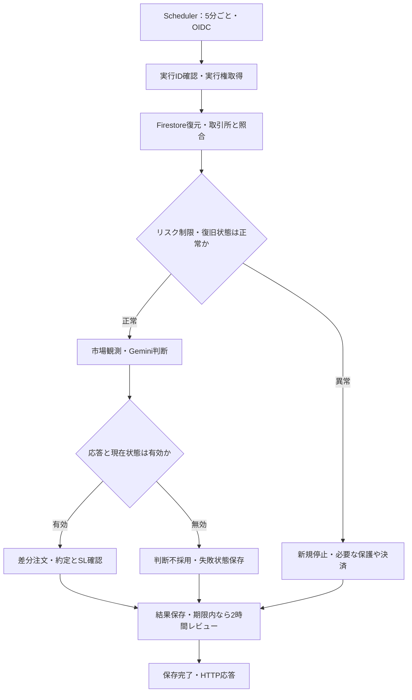
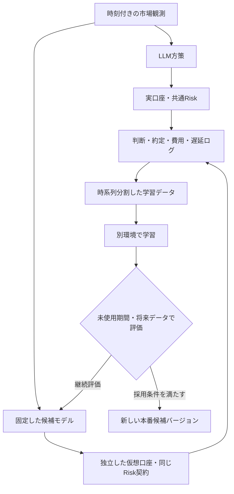

# BTC LLM取引bot：デプロイ・継続保有・強化学習の設計整理

- 作成日：2026-09-20
- 文書状態：会話に基づく設計ドラフト。実装・デプロイは未実施。
- 対象：Hyperliquidで動作する、新しいデプロイ用Pythonアプリケーション。
- 参照リポジトリ：`caprice1026-disc/bot_research`
- コード確認基準：[`994feaf87b061ec73381f4b0dca261f500c57146`](https://github.com/caprice1026-disc/bot_research/commit/994feaf87b061ec73381f4b0dca261f500c57146)。以降の変更は本書に未反映。

本書は、今回の実装で扱う内容と、将来の強化学習に備えて最初から用意する内容を整理する。未決の数値・製品設定を、既存コードのデフォルト値で暗黙に確定しない。

## 1. 状態の読み方

| 表記 | 意味 |
| --- | --- |
| 採用方針 | ユーザーが会話で明示した、今回の設計の前提。詳細設定や実装完了を意味しない。 |
| 提案 | 前提を具体化するための設計案。ユーザーが個別に確定した内容ではない。 |
| 未決 | 実装または運用開始前に決める必要がある事項。 |
| 現状確認 | 参照コード・公式資料から確認した事実。新アプリの仕様とは区別する。 |

## 2. 採用方針

| ID | 項目 | 方針 |
| --- | --- | --- |
| D01 | 対象市場 | 初期対象をHyperliquidのBTC取引とする。複数銘柄への拡張は後続課題。 |
| D02 | 売買判断 | LLMが5分ごとに、現在のポジションをどうするか判断する。判断機会と発注回数は別。 |
| D03 | 継続保有 | 判断周期をまたいで保有できる。5分ごとの一律決済・建て直しを前提にしない。 |
| D04 | 保護注文 | 取引所側SLを使用する。botの停止中も取引所に残る保護を持つ。 |
| D05 | 復旧 | 再起動後に状態を復元し、取引所の実際の建玉・注文・約定と照合する。 |
| D06 | レビュアー | レビュー間隔は2時間。5分のトレーダー判断と役割を分ける。 |
| D07 | LLM | Geminiを使う。具体的なモデル・予算・応答制限は未決。 |
| D08 | トレーダー入力 | 価格などの市場データを主入力とする。トレーダー自身が毎回ニュース検索する構成は前提にしない。 |
| D09 | 戦略状態 | レビュアーが、市場仮説・ルール・失敗傾向などの継続的な戦略状態を扱う。 |
| D10 | デプロイ構成 | Cloud SchedulerからOIDC認証でCloud Run Serviceを5分ごとに起動し、Firestoreに永続状態を置く方向。 |
| D11 | 既存実装の参照 | 基本実装は`hyperliquid-ai-trader`、ポジション管理は`llm-position-management`を参考にする。 |
| D12 | 将来の学習 | LLMによる運用を進めながら、通常の機械学習・強化学習モデルを育てる。学習の初回導入時期は未決。 |
| D13 | 市場への影響 | bot自身の注文が市場価格形成へ与える影響は無視する。手数料・スプレッド・Funding・約定遅延等は別途扱う。 |

Cloud Runの想定は`min-instances=0`、`max-instances=1`、`concurrency=1`。無料枠を活用することは目標だが、総費用がゼロになると確定したわけではない。

## 3. 現行コードとデプロイに向けた差分

### 3.1 参照する部分

| パッケージ | 現状確認 | 新アプリへの適用案 |
| --- | --- | --- |
| `hyperliquid-ai-trader` | Gemini、特徴量、レビュアー、取引所接続などを持つ。現行`run_once()`冒頭に`cleanup()`がある。設定はTestnet限定。 | 外部接続・特徴量・レビューの部品を利用し、継続保有とHTTP単発実行に合わせて制御を変更する。 |
| `llm-position-management` | 目標ポジションと現在数量の差分を扱う、状態を持つ実験。現状はシミュレーターであり、Gemini呼び出し・Hyperliquid実注文は行わない。 | hold、追加、縮小、決済、遅延応答の無効化、復旧の契約を参照する。実注文との接続を追加する。 |
| `trading-core` | Decimalを使った差分計画・費用会計・単一ポジションのオフラインシミュレーターなどを持つ。 | 共通の型・計算・リスク契約を置く候補。実運用・Replay・RLで計算が分岐しないようにする。 |

根拠：[既存runner](https://github.com/caprice1026-disc/bot_research/blob/994feaf87b061ec73381f4b0dca261f500c57146/hyperliquid-ai-trader/src/hyperliquid_ai_trader/runner.py)、[既存設定](https://github.com/caprice1026-disc/bot_research/blob/994feaf87b061ec73381f4b0dca261f500c57146/hyperliquid-ai-trader/src/hyperliquid_ai_trader/config.py)、[ポジション管理README](https://github.com/caprice1026-disc/bot_research/blob/994feaf87b061ec73381f4b0dca261f500c57146/llm-position-management/README.md)、[共通core README](https://github.com/caprice1026-disc/bot_research/blob/994feaf87b061ec73381f4b0dca261f500c57146/trading-core/README.md)。

既存の日次損失判定は実現損益を使用している。継続保有向けには含み損を反映した資産ベースの判定へ変更する。また、現行の損失上限やレバレッジのデフォルト値を、そのまま本番用の採用値とはしない。[現行risk.py](https://github.com/caprice1026-disc/bot_research/blob/994feaf87b061ec73381f4b0dca261f500c57146/hyperliquid-ai-trader/src/hyperliquid_ai_trader/risk.py)

### 3.2 新アプリの分割案【提案】

| 部分 | 責務 |
| --- | --- |
| HTTPハンドラー | 認証済みの予定実行を受け付け、期限内に1回分の処理を終える。 |
| 実行制御 | 実行ID、排他、重複判定、処理段階、再開、レビュー時刻を管理する。 |
| 市場観測 | 確定足・価格・板・Funding等を取得し、利用可能時刻を持つ観測を生成する。 |
| Policy | LLMまたは将来のMLモデルから、共通形式のポジション変更提案を得る。 |
| ポジション計画 | 現在数量と目標数量から、必要な注文差分を計算する。 |
| Risk | 数量上限、SL、損失制限、停止状態をコードで強制する。 |
| Exchange adapter | 注文、取消、約定取得、建玉・SLの照合を行う。 |
| State store | Firestoreへ状態・注文意図・イベントを保存する。 |
| Reviewer | 戦略状態の変更案と根拠を生成する。 |
| 学習・評価 | 保存データから学習環境・データセットを構築する。売買HTTP処理とは別実行。 |

新しいデプロイ用パッケージを用意する案とする。名称、配置、既存コードの移設範囲は未決。共通coreを利用する場合も、既存研究結果と互換性を確認しながら接続する。

## 4. 実行構成と1回の処理

### 4.1 Cloud Runでの動作【提案】

- リクエストベース課金を選び、1リクエストで1つの判断枠を処理する。
- コンテナ内の無限ループや`5分sleep`でスケジュールを維持しない。
- HTTP応答後のバックグラウンド処理に、発注・保存・学習の完了を依存させない。
- コンテナ内のファイル、SQLite、プロセスメモリを本番状態の正本にしない。
- 通常のリクエスト終了・インスタンス終了を理由に、保有ポジションを決済しない。
- OIDCの認証済み呼び出しだけを受け付け、Schedulerのサービスアカウントに呼び出し権限を与える。
- API鍵・署名鍵はSecret Manager等で管理する。戦略JSONや学習ログへ混入させない。

### 4.2 判断処理の流れ【提案】



1. `bot_id`、ネットワーク、口座、予定実行時刻を識別する。
2. 同じ予定枠の処理済み判定と、口座単位の実行権取得を行う。
3. 未確定注文、建玉、未約定注文、約定、Funding等を取引所と照合する。
4. 含み損込みの資産、SL、停止状態を確認する。未確定注文の解決が必要なら新しい戦略注文は出さない。
5. 判断時点までに利用可能な市場データと現在ポジションをLLMへ渡す。
6. 応答後に建玉・関連状態を再確認する。応答待ち中のSL決済などを検出する。
7. 有効な判断だけを数量計画へ変換し、Riskを再適用する。
8. 注文意図を永続化した後、必要な差分注文を送る。
9. 実約定数量と残注文を取得し、必要なSLが有効であることを確認する。
10. 結果と会計イベントを保存する。レビュー実行条件を満たせば、時間予算内でレビューする。

### 4.3 時刻とデータの契約【提案】

最低限、`scheduled_at`、`observed_at`、`data_available_at`、`decision_requested_at`、`decision_received_at`、`order_sent_at`、`filled_at`、`recorded_at`を区別する。

- 足の始値時刻だけで「その足が利用可能だった」と扱わない。確定前の高値・安値・終値を過去の判断へ渡さない。
- LLMが回答した後に取得した価格・ニュースを、入力時点の情報へ書き戻さない。
- 遅延実行で期限切れになった判断枠を、現在の新規注文として追いかけない。照合・保護は別途実施する。
- 5分は判断間隔であり、学習・保護注文再現に必要な市場データ粒度を意味しない。
- 観測時刻、応答遅延、約定遅延、欠損を本番・Replayで共通の意味にする。

### 4.4 2時間レビューの起動【提案・詳細未決】

初期案は、5分の同じSchedulerから、永続化された最終レビュー時刻と2時間枠IDで実行可否を判定する方式とする。再起動で回数がゼロに戻るカウンターには依存しない。

- 売買と保護を先に処理し、時間予算が足りなければレビューを次回へ延期する。
- レビュー結果はバージョン付きで保存し、次のトレーダー判断から適用する。
- 新しい戦略状態の適用だけを理由に即時決済しない。
- レビューが失敗した場合は、期限・停止方針の範囲で直前の有効な戦略を使う。
- レビューが頻繁に5分処理を圧迫する場合は、2時間ごとの別Schedulerジョブ・別処理へ分割する。

## 5. ポジション管理

### 5.1 行動の契約【提案】

LLMには、直接何度でも注文できる権限ではなく、1回のポジション変更提案を返させる。

| 意図 | 意味 |
| --- | --- |
| `hold` | 現在の数量を維持する。資産額や価格変化に合わせた自動再調整を含めない。 |
| `set_target` | 目標ポジションを指定する。新規・追加・縮小・決済を現在数量との差分に変換する。 |
| `set_target=0` | 建玉を解消する。 |

`target_fraction`等の離散値を使う案とする。ただし、選択肢、基準額、最大エクスポージャーは未決。基準額を使う場合は、承認された判断から計算した目標BTC数量を固定して保存し、再送時に価格が変わっても同じ注文意図を再計算しない。

リスク制約を理由とする縮小・決済は、LLMの`hold`より優先する。毎回同じ目標比率を出した際の細かな再調整を避けるため、最低発注額・数量丸め・変更幅の許容範囲を定義する。反転は、まず既存建玉を閉じ、残数量とSLを確認してから新規建玉を作る案とする。

### 5.2 判断が古くなった場合【提案】

観測に`position_version`、`account_version`、`risk_config_version`等を付ける。応答を適用する前に、判断の前提がまだ有効か確認する。

- 応答待ち中にSLで決済済みなら、古い追加・保有判断で建玉を開き直さない。
- 部分約定、手動操作、別処理による建玉変更があれば再照合する。
- 資産・Funding等の変化に対して、再検証で許容する範囲と応答破棄条件を定義する。
- 不正JSON・期限切れ・APIエラーを、新規エントリーへ変換しない。
- 連続失敗時の保有継続・縮小・決済条件は未決。失敗回数と決済待ち状態は永続化する。

## 6. 永続状態とレビュアー

### 6.1 正本の分担【提案】

実際の建玉・注文・約定は取引所を照合基準とする。戦略、注文意図、処理履歴、会計上の集計、停止判断はFirestoreに保持する。どちらか一方だけで、送信後クラッシュを完全に復元できるとは仮定しない。

以下はFirestoreの配置例であり、パス名は未決。口座・ネットワークが違うデータは混在させない。

| ドキュメント例 | 内容 |
| --- | --- |
| `bots/{bot_id}/strategy/current` | 現在の有効戦略、戦略バージョン、更新時刻。 |
| `bots/{bot_id}/strategy_versions/{version}` | 過去の戦略と更新根拠。後から上書きしない履歴。 |
| `bots/{bot_id}/runtime/current` | 実行リース、進行中処理、最終成功時刻、失敗回数、約定取得位置。 |
| `bots/{bot_id}/risk/current` | 高水位、日初資産、停止状態、停止期限、リスク設定バージョン。 |
| `bots/{bot_id}/decisions/{cycle_id}` | 観測参照、提案、採否、数量計画、遅延、モデル情報。 |
| `bots/{bot_id}/order_intents/{intent_id}` | 発注意図、クライアント注文ID、送信・照合・完了の状態。 |
| `bots/{bot_id}/events/{event_id}` | 約定、Funding、入出金、SL、リスク介入等の重複排除したイベント。 |
| `bots/{bot_id}/reviews/{review_id}` | レビュー入力範囲、変更案、採否、根拠、適用バージョン。 |

初期戦略JSONは、状態が存在しない場合の初期化にだけ使う。通常起動・デプロイ時に初期戦略で上書きしない。履歴を単一の巨大ドキュメントへ蓄積せず、期間・件数を限定して取得する。

### 6.2 戦略状態【採用方針＋提案】

会話で提示された形に対応するのは、既存の[`hyperliquid-ai-trader/state/strategy.json`](https://github.com/caprice1026-disc/bot_research/blob/994feaf87b061ec73381f4b0dca261f500c57146/hyperliquid-ai-trader/state/strategy.json)。これを土台とする。

| フィールド | 方針 |
| --- | --- |
| `version` / `parent_version` | 更新前後の対応を保持する。 |
| `market_hypothesis` | 現在の市場仮説。事実と推測を区別する。 |
| `active_rules` | 有効な売買ルール。件数・長さを制限し、無制限に追記しない。 |
| `failure_modes` | 過去に失敗した条件。対応するイベント・取引へリンクする。 |
| `confidence_calibration` | 継続保有で何を正解とするかを再定義する必要がある。LLMの自己申告を勝率にしない。 |
| `last_review_cycle` | ローカル連番だけに依存しない。絶対時刻・レビューIDを併記する。 |
| 追加候補 | `schema_version`、`updated_at`、`review_window_id`、`evidence_ids`、`change_reason`、情報の有効期限。 |

レビュアーには、現在の戦略、今回までに確定した観測・取引・費用、未決済ポジションの推移、比較対象の成績を渡す。2時間で十分な取引が発生するとは限らないため、必要な履歴を参照しつつ、根拠不足なら変更なしを許可する。

変更は、レビュアーの提案、スキーマ・変更範囲の検証、元バージョン一致の確認、保存という順で適用する。リスク上限、取引口座、発注権限、停止解除条件は戦略変更の対象に含めない案とする。

### 6.3 Google検索グラウンディング【未決】

検索を使う場合の担当は2時間レビュー側とする案。トレーダーは、保存済みの戦略状態を通じてその影響を受ける。

- 採用の有無、対象ニュース、検索予算、有効期限、変更可能な戦略範囲を決める。
- URL、取得時刻、確認できた公開時刻、要約、採用根拠を保存する。公開時刻が不明なら不明と記録する。
- 未検証の検索文面を設定変更や発注命令として扱わない。
- 過去Replayに現在の検索結果を混入させない。当時取得していない情報は、当時の判断に使用しない。
- 検索あり・なしを比較できるよう、戦略とモデル設定を識別する。

検索とモデルの料金・上限はCloud Runとは別に管理する。[Gemini API料金](https://ai.google.dev/gemini-api/docs/pricing)、[API利用制限](https://ai.google.dev/gemini-api/docs/rate-limits)

## 7. SL・DD・損失制限

### 7.1 制御の分担

| 制御 | 状態 | 役割 |
| --- | --- | --- |
| 取引所側SL | 採用方針 | botが停止している間も、保有ポジションを保護する。 |
| 日次損失または日次DD | 導入を検討中 | その日の損失拡大・連敗を止める。定義・数値は未決。 |
| 時間単位の損失またはDD | 導入を検討中 | 短時間の不調を検出する。毎正時か直近60分かは未決。 |
| 累積DD | 提案 | 日付変更をまたぐ資産減少を制限する。 |
| 停止・決済・再開ルール | 未決 | 上限到達後に何をし、いつ再開するか定める。 |

日次・時間単位の制限は、取引所SLと併用する案とする。5分ごとの口座確認は連続監視ではなく、その間の急落と回復を見落とす可能性がある。記録できた最大DDと、実際に発生した最大DDを同一視しない。

### 7.2 指標の定義案

`E_t`を含み損益・取引費用・Funding反映後の資産、`E_day_start`を日初資産、`H_t`を対象期間内の資産高水位とする。入出金は損益から除外し、基準額への反映方法を定める。

- 日次損失率：`max(0, (E_day_start - E_t) / E_day_start)`。
- DD率：`max(0, (H_t - E_t) / H_t)`。
- 時間単位の提案：直近60分に観測した資産高水位からのDDと、到達後のクールダウンを組み合わせる。
- 累積DDの高水位：起動・レビュー・日付変更でリセットしない。

日次の境界タイムゾーン、時間窓の欠損時処理、停止中のFunding、入出金の扱いは未決。最初はbot専用口座・サブアカウントで会計対象を限定する案とする。

上限到達時は、コードが新規・追加を停止し、必要な縮小・決済を実行する。日付・時間窓が変わっただけで停止を自動解除せず、保存した停止条件に従う案とする。

### 7.3 SLの計算案【未確定】

SLの計算はコードで行う案とする。LLMにSL提案を許す場合も、コード側の損失上限で検証する。最終的に、価格変動幅・ATR等を基準にするか、損失予算を基準にするか、両方を使うかは未決。

単一BTCポジションで、損失予算から計算する場合の概算は以下。

```text
q = 現在のBTC保有数量の絶対値
R = 固定されたリスク基準に対して、ここから失ってよい残額（USD）
C = 決済手数料・スリッページ等に確保する余裕（USD）
P = 現在の基準価格（USD/BTC）

許容逆行幅 = (R - C) / q
ロングSL = P - 許容逆行幅
ショートSL = P + 許容逆行幅
```

適用条件は`q > 0`かつ`R > C`。残額不足は新しい遠いSLを置く理由にせず、縮小・決済の対象とする。Rはポジション単位・日次・時間単位などの有効な制限から厳しいものを選ぶ。単一の線形BTC建玉を前提とする近似であり、複数建玉や他資産の変動を扱う場合は拡張が必要。

- 含み損発生後、現在価格から同じ初期予算で置き直さない。残予算の基準を維持する。
- 保有中のSLは原則として緩めない。追加・日付変更・レビューでリスク予算を自動再配布しない。
- 数量追加・部分決済後は、実際の残数量を保護しているか確認する。
- 丸め、最小注文、清算価格との位置関係、許容スリッページを検証する。
- 新規約定後にSL設置が失敗した場合は、状態を保存して優先復旧する。設置不能時の緊急決済条件を実装前に決める。
- SL変更時に無保護となる時間を抑える。注文グループや変更APIの挙動はTestnetで確認する。

HyperliquidのTP/SLはmark priceで発動する。固定数量のSLや親注文に付随するSLには、数量変更・部分約定時に注意が必要。SL価格での約定が保証されるわけではないため、DD制限額の厳密な保証とはしない。[Hyperliquid TP/SL仕様](https://hyperliquid.gitbook.io/hyperliquid-docs/trading/take-profit-and-stop-loss-orders-tp-sl)

## 8. 重複発注・再起動・障害への対応

### 8.1 最低限必要な契約【提案】

Cloud Schedulerは少なくとも1回の配信を行う設計で、同じ予定実行が重複する可能性がある。`max-instances=1`と`concurrency=1`だけを排他・重複防止の根拠にしない。ジョブ名と、再試行でも変わらない`X-CloudScheduler-ScheduleTime`を利用して実行IDを作る。[Scheduler仕様](https://docs.cloud.google.com/scheduler/docs/overview)

| 対象 | 設計案 |
| --- | --- |
| 予定実行 | 予定時刻を含む安定した`cycle_id`を使う。到着時刻から毎回別IDを作らない。 |
| 実行権 | Firestoreの短いトランザクションで、所有者・有効期限・世代番号を持つリースを取得する。 |
| 発注意図 | 取引所への送信前に、注文パラメーターと`intent_id`を保存する。 |
| 注文識別 | 意図から安定したクライアント注文IDを割り当て、取引所側の結果と照合する。 |
| 結果不明 | タイムアウトを未発注と決めつけず、注文・約定・建玉を調べてから次の操作を決める。 |
| 復旧 | 未解決の意図を解決するまで、同じ口座の新しい戦略注文を抑止する。 |
| 履歴取り込み | 約定・Funding等はイベントIDで重複排除し、取得範囲を重ねても二重計上しない。 |

Firestoreと取引所への書き込みを1つの原子的処理にすることはできない。リース期限切れだけでは、旧処理からの外部注文がなかったことを証明できない。世代確認・実行期限・未確定意図の照合を組み合わせる。

Firestoreのトランザクションは再実行され得るため、トランザクション関数内でGeminiや取引所への外部呼び出しをしない。[Firestoreトランザクション仕様](https://firebase.google.com/docs/firestore/manage-data/transactions)

また、Cloud RunのHTTPタイムアウトは、処理コードが停止した保証ではない。アプリ側でも期限を監視し、期限切れ後の新しい注文送信を抑止する。LLM・取引所API・HTTP・Schedulerの各タイムアウトを整合させる。[Cloud Runタイムアウト仕様](https://docs.cloud.google.com/run/docs/configuring/request-timeout)

### 8.2 障害別の扱い案

| 状況 | 基本動作 | 未決の詳細 |
| --- | --- | --- |
| 同じ予定枠が再配信 | 完了済みなら再発注しない。途中なら照合・再開。 | 再試行回数・期限。 |
| Gemini失敗・不正応答 | 失敗を記録し、新規エクスポージャーを作らない。 | 何回・何分で既存建玉を閉じるか。 |
| Firestoreが読めない | 通常の戦略注文を停止する。取引所上の既存SLは残す。 | 保存不能時に許す緊急操作と識別方法。 |
| 取引所の状態が取得できない | 建玉不明として新規注文を停止する。 | 再照会・通知・復旧期限。 |
| 発注後に応答が途絶えた | 未確定意図として照合する。無条件に再発注しない。 | クライアントIDの照会・再送契約。 |
| 建玉はあるがSLがない | SL復旧を優先し、必要なら緊急決済。 | 復旧猶予、部分約定、保護方式。 |
| リスク上限到達 | 新規停止、所定の縮小・決済、停止状態を保存。 | 停止時間・再開条件。 |
| 再起動・デプロイ | 同じbot状態を復元し、取引所と照合する。 | 設定・スキーマ変更時の移行方法。 |

停止操作は「新規停止」「管理を継続しながら縮小」「全決済」「Scheduler停止」を区別する。Schedulerだけを止めても建玉は閉じないため、停止手順に取引所状態の確認を含める。

## 9. 強化学習を見据えた設計

### 9.1 目的と初期導入範囲

LLMを動かしながら通常のモデルを育てる方針を採る。ただし、LLMの出力を正解として模倣することと、損益から強化学習することは別の学習目的である。

初期デプロイでは、学習に必要なデータ・共通インターフェースを用意する案とする。勾配更新・大規模Replay・モデル比較を、5分の売買HTTP処理に同居させない。学習環境の保存先・実行場所・予算は別に決める。

### 9.2 同じ時系列で並走する構成【提案】

市場への影響を無視する前提なら、同じ市場データを複数の方策へ配信できる。ただし、行動によって建玉・現金・手数料・Funding・SL・次の観測状態が変わるので、モデルごとに独立した仮想口座を持たせる。



- 仮想モデルが異なる行動をした後に、口座状態をLLMの実口座へ毎回戻さない。
- LLMの実現した損益を、異なる行動を選んだRLモデルの報酬として流用しない。
- 注文が市場を動かさなくても、スプレッド・板の厚さ・部分約定・遅延は執行コストに影響する。
- 実口座で採らなかった行動の結果は推定であり、実測約定と区別する。
- モデル更新は本番判断とは切り離す。比較期間中はモデルを固定し、更新後は別バージョンとして扱う。

### 9.3 学習方法の候補【未決】

| 方法 | 使うデータ・目的 | 制約・位置づけ |
| --- | --- | --- |
| 教師ありの収益・リスク予測 | 市場特徴量から将来収益・変動等を予測し、共通Riskと発注計画へ接続。 | LLMやRLと比較する基本モデルの候補。未来ラベルの重なりと時系列分割に注意。 |
| LLMの行動模倣 | LLMの観測と判断を使い、小さいモデルへ方策を近似。 | 推論費用削減や初期化に使える可能性。LLMの誤りも学ぶため、収益性の保証にはならない。 |
| オフラインRL | 保存された状態・実行行動・報酬・次状態から学習。 | ログに乏しい行動の価値を過大評価する問題を考慮し、手法と評価を選ぶ必要がある。 |
| Replay環境内でのRL | 過去市場を再生し、候補方策自身の行動で仮想口座を遷移させる。 | 多くの試行が可能だが、約定・SLの近似に過適合する可能性がある。 |
| 将来データでのshadow運用 | 新しい市場観測に対して候補方策を動かす。 | 実注文を出さない前向き評価。データを貯めて後から追加学習できる。 |

推奨する導入順は、記録・Replay環境の整備、単純モデルとの比較、必要に応じた模倣学習、RL、将来shadowでの検証とする。模倣学習を必須の前段階にはしない。

PPOを採用するとしても、LLMのログをそのままPPO自身のon-policy軌跡として扱わない。PPOは自身の方策で得たデータを使う方式であり、LLMの行動ログは模倣用データ等として別に扱う。Geminiの自己申告confidenceは行動確率やPPOのlog probabilityではない。[OpenAI Spinning Up：PPO](https://spinningup.openai.com/en/latest/algorithms/ppo.html)

具体的なアルゴリズム、ネットワーク、学習頻度は未決。5分の単一方策では30日で8,640判断しかなく、時系列相関もあるため、件数を独立サンプル数とみなして学習成立を判断しない。

### 9.4 観測・行動・報酬の共通契約【提案】

**観測**には市場特徴量だけでなく、現在数量、取得価格、含み損益、保有時間、残りリスク予算、既存SL、停止状態、未確定注文を含める。学習時も、その時点の自分の仮想口座から生成する。

**行動**は本番と同じ`hold`・目標ポジション変更を使う案とする。SLをモデルの行動に含めるかは未決。初期案ではコード側でSLを決め、行動空間を絞る。

**報酬**は、費用を反映した資産変化を基本とする。候補例は以下。

```text
r_t = (次の評価時点の純資産 - 現在の純資産 - 期間中の純入金額)
      / 固定したエピソード開始資産
```

- 純資産にすでに手数料・Fundingが反映されていれば、報酬から再度引かない。
- スリッページが約定価格に含まれている場合も二重控除しない。
- 決済した時だけ利益を評価せず、保有中の含み損益を評価する。
- 最大DDなどのペナルティを追加するか、その係数は未決。ハード上限のコード制御は維持する。
- LLMへの一致率・レビューの文章評価を、そのまま収益報酬にはしない。
- 市場PnLと、LLM・検索・インフラを含む運用純利益を分けて報告する。API費用を学習報酬に含めるかは未決。
- Riskによる上書きを環境遷移に含め、提案行動と実行結果を記録する。学習用actionをどちらで定義するかを固定する。

固定5分の環境なら、区間内のSL・Funding・部分約定を処理した上で次状態を作る。実ログの遷移時間が不規則な場合は、`delta_t`を保持し、固定刻みへの変換または時間に応じた割引方法を決める。システム再起動を経済的なエピソード終了にしない。

### 9.5 最初から保存するデータ【提案】

| 分類 | 最低限の情報 |
| --- | --- |
| 識別 | bot・口座区分・ネットワーク・銘柄、cycle・decision・intent・event ID。 |
| 市場入力 | 実際に使った特徴量と元データ参照、各時刻、データ品質・欠損状態。 |
| 方策入力 | 建玉・資産・SL・リスク予算・戦略状態の、その判断時点のスナップショット。 |
| 方策設定 | モデルID、返されたモデル情報、プロンプト・スキーマ・特徴量のバージョン、推論設定、コードcommit。 |
| 判断 | LLMの応答、検証結果、提案行動、Risk適用後の行動、採否・理由。 |
| 発注・約定 | 実注文パラメーター、クライアントID、約定価格・数量・時刻、部分約定、SLの状態。 |
| 会計 | 実現・未実現損益、手数料、Funding、入出金、資産、高水位、停止イベント。 |
| 実行品質 | 応答時間、発注遅延、エラー、再試行、復旧、レート制限。 |
| コスト | トークン使用量、検索使用量、モデル・API費用。未取得値は推測値と区別。 |
| 学習用変換 | 状態・行動・報酬・次状態の参照、delta_t、終了・打ち切り・欠損フラグ、データセット版。 |

LLMが返した理由は保存できるが、非公開の内部思考を取得することは前提にしない。失敗・見送り・holdを捨てず、利益が出た取引だけのデータセットにしない。

将来のReplayには5分の判断スナップショットだけでは不十分な場合がある。確定足、mark price、必要な板・約定情報、Fundingなどを、どの粒度で記録・再取得するか決める。足のOHLCだけでSLと約定の厳密な前後関係が分からない区間は、不確実として扱う。

Firestoreは本番復旧と直近参照に使い、長期間の生データや学習データはParquet等でオブジェクトストレージへ出す案とする。保存先、保持期間、エクスポート頻度、欠損検証、追加費用は未決。

### 9.6 レビュアー情報と学生モデルの整合

レビュアーがニュースを使い、トレーダーがその戦略状態に従う場合、価格だけを入力する学生モデルは教師と同じ情報を持たない。以下のどちらを評価するか決める。

1. 学生にも、その時点で有効だった戦略・市場レジーム等を渡す。
2. 学生は価格等だけの独立モデルとして扱い、教師の判断を完全に再現することを目的にしない。

未来のレビューで更新された戦略を、過去の学生入力へ適用しない。学習期間の戦略更新も時系列順に再生する。LLMや戦略の更新は方策変更として記録する。

### 9.7 評価と本番採用【提案】

- 学習・調整・最終評価の期間を時系列順に分ける。正規化等も学習期間で適合する。
- ラベルや保有期間が境界をまたぐ場合は、重複による情報漏洩を避ける分離幅を設ける。
- 将来の結果を使って学習してから、同じ過去時点へ戻してshadow結果を更新しない。
- 同じ評価期間を繰り返し調整に使ったら、その期間は最終未使用評価ではなくなる。
- 現金維持、固定エクスポージャー、単純ルール、通常ML、LLM、RLを共通の費用・Riskで比較する。市場エクスポージャーや売買回転率の差も報告する。
- 純利益、DD、売買回転率、保有時間、実取引数、コスト比率、停止回数、データ完全性を確認する。
- LLMの過去相場に関する学習済み知識や、Replayの執行近似があるため、歴史データの好成績だけで採用しない。
- 前向きshadowでは候補モデルを固定し、モデル自身の独立口座で評価する。
- 評価期間、必要取引数、比較対象、採用基準を事前に決める。不足時は判定保留とする。
- 本番切り替えはバージョンを指定して行い、前の方策に戻せるようにする。学習完了だけを理由に自動切り替えしない案。

モデルの優劣は未検証。LLM、RL、両者の組み合わせのいずれが最適かは、本設計では確定しない。Jevを含む外部モデルの導入も未決で、初期デプロイの必須依存には含めない案とする。

## 10. 費用と無料枠

### 10.1 30日換算の呼び出し量

- トレーダー：`24 × 60 / 5 × 30 = 8,640回/月`。
- レビュアー：`24 / 2 × 30 = 360回/月`。
- 合計LLM呼び出しの基準：9,000回/月。再試行・複数段呼び出し・検索は別途。
- 同じHTTP処理内でレビューする場合、Cloud Runへの予定リクエストは基準8,640回/月。

### 10.2 インフラの見込み【2026-09-20確認】

| サービス | 無料枠・注意点 |
| --- | --- |
| Cloud Scheduler | 請求先アカウントごとに3ジョブ無料。課金単位は定義したジョブで、各回の実行ではない。[料金](https://cloud.google.com/scheduler/pricing) |
| Cloud Run | リクエストベースでは月18万vCPU秒、36万GiB秒、200万リクエストが無料枠の基準。無料枠は請求先アカウントで共有し、地域等で料金が変わる。[料金](https://cloud.google.com/run/pricing) |
| Firestore | StandardのデフォルトDBでは、日5万読み取り・2万書き込み、保存1GiB等が無料枠。全履歴検索、インデックス、蓄積量に注意。[料金](https://cloud.google.com/firestore/pricing) |
| その他 | Gemini・検索、コンテナ保存、ビルド、ログ、外向き通信、秘密情報管理、学習データ保存は各サービスの条件を確認する。 |

1vCPU・512MiB、通常処理を`T`秒、レビューの追加時間を30秒と仮定すると、CPU使用量の概算は`8,640 × T + 360 × 30` vCPU秒/月。

| 通常処理の時間 | CPU使用量/月 | 無料枠超過分のCPU料金の概算 |
| --- | ---: | ---: |
| 15秒 | 140,400 vCPU秒 | $0 |
| 30秒 | 270,000 vCPU秒 | 約$2.16 |

料金例はTier 1のCPU単価を使用し、他の利用による無料枠消費、起動・終了、再試行、追加処理を除く。Geminiの応答待ちもHTTP処理中の課金時間に含まれる。総費用がゼロであるという見積もりではない。[Cloud Run料金・課金時間](https://cloud.google.com/run/pricing)

学習処理の費用はこの概算に含まない。無料枠に収めるために保護・照合処理を省略する設計にはしない。稼働後は処理時間、API費用、保存量を実測して見積もりを更新する。

## 11. 未決事項一覧

「実装前」はインターフェースや安全な遷移を確定する時点、「実資金前」は資金を使う運用を開始する前を意味する。下記の推奨案は採用済みではない。

| ID | 未決事項 | 現時点の案・選択肢 | 決める時点 |
| --- | --- | --- | --- |
| Q01 | 初回デプロイのモード | dry-run、Testnet、実資金のどこまでを初回対象にするか。段階導入を提案。 | デプロイ設定前 |
| Q02 | 資金・口座・レバレッジ | 専用口座、証拠金方式、初期資金、最大建玉。既存値は引き継ぎ未承認。 | 実資金前 |
| Q03 | 行動空間 | 目標比率の離散値、基準額、増減・反転の許可、最小変更幅。 | 実装前 |
| Q04 | 入力データ | 5分判断に渡す足の期間・複数時間足・板・Funding・履歴長・欠損判定。 | 実装前 |
| Q05 | SLの決定方式 | 損失予算、ATR等、LLM提案＋制約のどれを採るか。数量変更時の更新方式。 | 実装前 |
| Q06 | DD・損失制限 | 日初基準か高水位基準か、各数値、累積上限、含める資産の範囲。 | 実資金前 |
| Q07 | 時間窓・停止解除 | 毎正時か直近60分か、日次タイムゾーン、クールダウン、再開条件。 | 実装前 |
| Q08 | 障害時の建玉管理 | LLM失敗の許容回数・時間、SL設置失敗、DB障害時の緊急決済。 | 実装前 |
| Q09 | LLM設定 | トレーダー・レビュアーのモデル、温度、出力上限、タイムアウト、月予算。 | 接続検証前 |
| Q10 | 検索グラウンディング | 使用有無、検索範囲、予算、出典保存、情報の有効期限。 | レビュー実装前 |
| Q11 | レビュアー権限 | 変更可能項目、採用条件、履歴長、ルール数、戦略の有効期限。 | 実装前 |
| Q12 | GCP設定 | プロジェクト、利用可能な地域、課金アカウント、CPU・メモリ、Firestore配置。地域はサービス利用条件も確認。 | デプロイ設定前 |
| Q13 | スケジュールと期限 | 同一処理内レビューか別ジョブか、アプリ・HTTP・APIの各期限、再試行・古い枠の扱い。 | 実装前 |
| Q14 | 永続化と移行 | コレクション・スキーマ、ロック・注文ID契約、デプロイ時移行・ロールバック。 | 実装前 |
| Q15 | データ保存 | 生データ粒度、保持期間、エクスポート先、欠損検証、保存費用。 | 運用記録開始前 |
| Q16 | 監視・通知 | heartbeat、未保護建玉、未確定注文、遅延、損失停止、通知先・閾値。 | 継続稼働前 |
| Q17 | RL導入時期・手法 | 初回は記録のみか、shadowまで含むか。模倣・通常ML・offline RL・Replay RLの選択。 | 学習実装前 |
| Q18 | RLの契約 | 状態、行動、報酬、エピソード、割引、Risk介入、検索情報の受け渡し。 | データセット確定前 |
| Q19 | 学習基盤 | CPU/GPU、ローカル/クラウド、実行頻度、履歴長、予算、モデル保存先。 | 学習実装前 |
| Q20 | 評価・採用基準 | 比較対象、未使用期間、必要件数、費用・DD条件、shadow期間、切り替え方法。 | 候補評価開始前 |
| Q21 | Jev・複数銘柄 | 初期BTC構成の後で検討するか。導入効果と役割は未検証。 | 拡張時 |
| Q22 | 新アプリの配置 | パッケージ名、共通coreの利用範囲、HTTPフレームワーク、IaC・CI方式。 | 実装着手時 |

## 12. 実装・検証の進め方【提案】

| 段階 | 作業 | 完了条件 |
| --- | --- | --- |
| 1. 契約の確定 | 行動、Risk、SL、時刻、注文意図、停止・復旧、保存スキーマを定義する。 | Q03〜Q08、Q11、Q13〜Q15等の実装に必要な事項が決まり、数値未定箇所が明示されている。 |
| 2. 単発実行基盤 | HTTPハンドラー、Firestore、取引所照合、重複防止、ログを実装する。 | 再送・途中停止・再起動でも注文と会計を二重処理しない。 |
| 3. 継続保有とLLM | Gemini判断、差分注文、SL、2時間レビューを接続する。 | holdで不要な注文が出ず、古い応答を拒否し、SL・停止状態を復元できる。 |
| 4. クラウド機能確認 | OIDC、Scheduler、Cloud Run、権限、タイムアウト、監視を確認する。 | 実際のクラウド環境で繰り返し処理でき、費用・遅延が計測できる。 |
| 5. 実行・収益の評価 | Testnetで注文挙動を確認し、同じ市場の将来データでshadow評価する。 | 注文機能の正常性と、費用込みの戦略評価を別々に判定できる。 |
| 6. 初期運用 | 資金・損失上限・停止手順・運用費を定めて運用する。 | 約定・会計照合とSL監視が成立し、将来学習用データが蓄積される。 |
| 7. ML・RL追加 | Replay、通常ML、必要な模倣学習・RL、独立shadow口座を追加する。 | 未使用データによる比較結果と、採用・保留の判断根拠が保存される。 |

### 12.1 優先して確認する障害シナリオ

- 同じ5分枠の重複配信、処理途中の再配信、予定時刻を過ぎた再試行。
- 注文意図保存後・送信後・約定後・Firestore反映前のそれぞれでのプロセス停止。
- LLM応答待ち中のSL決済、部分約定、手動建玉変更。
- 追加・縮小後のSL数量不一致、SL設置失敗、反転途中の失敗。
- 含み損での日次・時間・累積上限到達と、再起動後の停止継続。
- 日付・時間窓の境界、Funding・入出金の重複取り込み。
- Gemini、Firestore、Hyperliquidのタイムアウト・一時停止。
- 学習データの未来情報混入、費用二重計上、学生口座と教師口座の混同。

これらは金銭・状態の整合性に関わる検証とし、単に実装と同じ式をなぞるテストで代替しない。既存のReplay成功は参考にするが、Firestore・実取引所・クラウド障害からの復旧が確認済みとは扱わない。

本書は設計整理までを対象とする。具体的な設定値、資金投入、検索や学習の追加費用、モデル採用を確定した文書ではない。
