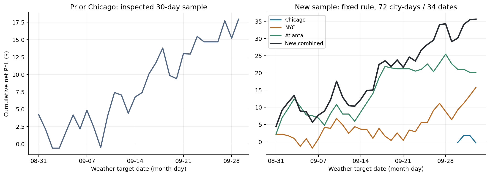
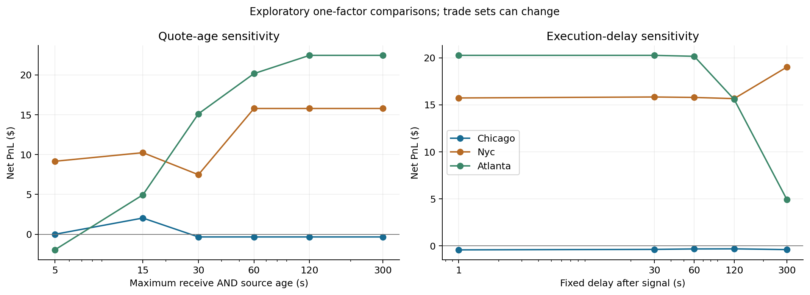
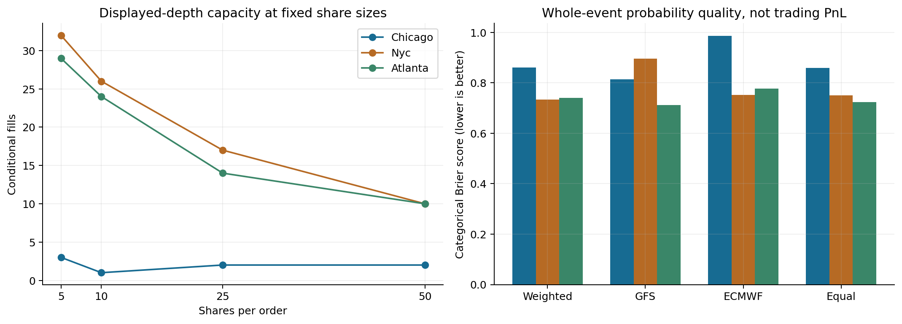

# 天気予報差の追加研究

実施日: 2026-10-05。対象はPolymarketの日次最高気温市場。金額は担保通貨のドル相当で、税・送金費用を含まない。ここでいう約定は、過去の実ask・表示数量に条件を置いた仮想約定である。

## 結果と判断

前回のChicagoで見た利益は、追加したNYC・Atlantaでも再現した。固定した主要条件では、新しい72都市日・34暦日の64約定で **+35.60954ドル**。ただし、過去7日間の気温平均だけを使う比較モデルも **+27.92558ドル**だった。日付を揃えた追加利益は **+7.68396ドル、95%区間[−5.40544, 21.25928]**。気象予報モデルを使う追加価値は、今回の標本では確認できない。

したがって、評価は「表示板での利益機会を継続検証する研究候補」とする。実運用の収益性、5株を超える容量、気象予報の優位性は未確認である。追加研究の主条件を変えず、感度分析で最も利益が出た設定への差し替えもしていない。

| 新しい評価対象 | 実測期間 | 日数 | 仮想約定 / 勝ち | 純損益 | 3日ブロックの95%区間 |
|---|---|---:|---:|---:|---:|
| Chicago / KORD | 2026-09-30〜10-03 | 4 | 3 / 1 | −0.33140 | [−4.53140, 3.86860] |
| NYC / KLGA | 2026-08-31〜10-03 | 34 | 32 / 16 | +15.78206 | [−6.16562, 38.27914] |
| Atlanta / KATL | 2026-08-31〜10-03 | 34 | 29 / 15 | +20.15888 | [−7.56450, 49.84022] |
| 合算 | 34暦日 / 72都市日 | 34 | 64 / 32 | **+35.60954** | **[1.38324, 67.96112]** |

合算の区間は正でも、都市別は全てゼロを含む。Chicagoの後続は4日しかなく、再現性を判断できる量ではない。合算は各都市1,000ドル、合計3,000ドルの初期資金に対して **+1.186985%**。累計購入費用124.39046ドルに対する28.627228%を、運用資金全体の収益率と混同しない。

主要結果の手数料は3.20046ドル、最終現金は3,035.60954ドル。公式決着まで購入費用を拘束し、最低現金2,994.42602ドル、最大同時拘束額6.73608ドルを確認した。決済時資産の最大ドローダウンは0.30454%だが、日中の含み損や強制換金時の損失を測った値ではない。



この図は気温の対象日ごとに帰属させた損益で、現金が実際に入金された時刻の残高推移ではない。前回のChicago30日を新しい合算へ加えていない。

## 何を固定して検証したか

新しい損益を計算する前に、[設定](weather_deep/config.json)を保存した。設定のSHA256は `9a12e61422a35ecc702efd7b4e843515e06510e20769935ef7f45f10008b85ab`。これは作業内の固定記録で、第三者への事前登録ではない。

予報はGFSとECMWFの当日00 UTC runを使用し、6時間後に公開されたと仮定する。現地午前10時に一度だけ判断する。Chicagoは15 UTC、NYCとAtlantaは14 UTC。各都市の校正は2026-08-01〜08-30の30日で、評価期間の最高気温・決着から重みや誤差幅を学習しない。観測地点は市場が指定する空港で、都市中心点へ置き換えない。

校正では、各モデルの過去の平均絶対誤差の逆数から重みを求め、予報とIEM観測最高気温の差の平均を補正する。残差の標準偏差と2°Fの大きい方を誤差幅σとする。最高気温を正規分布として扱い、整数の温度区間[lo, hi]のYes確率を `CDF(hi + 0.5) − CDF(lo − 0.5)` で計算する。Noの予報確率はその補数だが、Noの売買価格・数量は実際のNo tokenの板を使う。

| 地点 | GFS重み | ECMWF重み | 平均補正°F | σ°F |
|---|---:|---:|---:|---:|
| Chicago | 0.4973 | 0.5027 | −0.6233 | 2.0000 |
| NYC | 0.3512 | 0.6488 | −0.8869 | 2.2527 |
| Atlanta | 0.3510 | 0.6490 | −0.5839 | 2.0000 |

売買では、手数料と不利な価格差1セントを加えた1株当たり費用を予報確率から引き、期待差が8ポイント以上の候補を選ぶ。判断時点で期待差が最大の候補に、各都市1日1回、5株を試行する。60秒後の実askと数量を検査し、判断時・執行時とも板の受信時刻と配信元時刻の鮮度が60秒以内でなければ取引しない。判断時刻と同時のイベントは参照しない。執行後に都合のよい別候補へ選び直す処理もない。

費用は[Polymarket公式資料](https://docs.polymarket.com/trading/fees)の `株数 × 0.05 × p × (1 − p)` を小数5桁に丸めて使用する。現在の費用を過去へ適用した比較であり、当時請求された手数料の復元ではない。価格差1セントは不利な費用の仮定で、当時のtickに沿った注文価格や注文受理を証明するものではない。価格は判断時askから5セントを超えて悪化すると拒否する。

## 気象予報を使う追加価値

単純な比較モデルとして「前7暦日のIEM最高気温の平均」を予報とした。当日・将来の気温は特徴量に入れない。平均補正とσは同じ校正期間内で求めるが、7日前までの履歴が揃う8月8〜30日の23日を使う。対象市場・評価日・期待差・板鮮度・遅延・数量・価格差・費用・現金制約は主要条件と同じ。7日平均の方が誤差幅は広く、同じ注文を買う比較ではない。

| 地点 | GFS・ECMWFの純損益 | 7日平均の純損益 | 差 |
|---|---:|---:|---:|
| Chicago | −0.33140 | −0.39961 | +0.06821 |
| NYC | +15.78206 | +16.00184 | −0.21978 |
| Atlanta | +20.15888 | +12.32335 | +7.83553 |
| 合算 | +35.60954 / 64約定 | +27.92558 / 69約定 | **+7.68396** |

7日平均の合算95%区間は[−1.95691, 55.54541]。予報モデルから7日平均を引いた**日次の差**を、同じ34暦日・3日ブロックで再標本化すると[−5.40544, 21.25928]になる。個別の区間を単純に引き算した値ではない。

この比較は主要結果を見た後に追加した探索的な対照である。気象予報の優位性を否定する確証にはならないが、利益の全額をGFS・ECMWFの情報価値とみなす根拠は崩れる。No側や温度区間の価格設定、選択規則、偶然でも説明できる部分が残る。NYCでは単純モデルの方が僅かに良かった。

## 予報誤差と確率の正確さ

| 評価対象 | 主モデルの平均絶対誤差°F | 全温度区間のBrier | 対数損失 | 気温95%区間の包含率 |
|---|---:|---:|---:|---:|
| 前回Chicago30日 | 1.9826 | 0.7994 | 1.6919 | 93.33% |
| 新Chicago4日 | 2.0545 | 0.8603 | 1.6839 | 100.00% |
| NYC34日 | 1.6743 | 0.7329 | 1.5299 | 97.06% |
| Atlanta34日 | 1.7049 | 0.7395 | 1.4864 | 94.12% |

Brierはその日の全11区間の `Σ(予報確率 − 公式勝者ラベル)²`。小さいほどよい。気温の誤差・包含率はIEMを基準とし、区間Brier・対数損失は公式決着を基準とする。測っている対象が異なる。

単一モデルも、同じ過去期間だけで平均・誤差幅を校正して比較した。NYCではECMWF単独の平均絶対誤差1.6324°Fが重み付き1.6743°Fより小さい。AtlantaではGFS単独1.5804°Fが重み付き1.7049°Fより小さく、区間Brierも0.7119対0.7395だった。同じ重み付けが各地点で最良とは限らない。これを見て利益モデルを地点別に差し替えることはしていない。

選択した64約定の平均予報勝率は62.71%、実際の勝率は50.00%。比較可能な選択取引の二値Brierは、NYCがモデル0.2178・市場mid0.2080、Atlantaがモデル0.2300・市場mid0.2534。Chicagoは3取引しかない。モデルが全地点で市場より確率をよく予測している証拠はない。これらはモデルが選んだ取引だけの二値評価で、全11区間のBrierと数値を直接比較できない。少数の高確率取引での外れもあり、正規分布と固定σによる過信を疑う理由はあるが、校正の欠陥を統計的に確定したわけではない。

## 利益の集中と前回結果の見直し

新しい64約定のうちNoは51約定で+31.44840ドル、Yesは13約定で+4.16114ドル。純利益の約88%がNoから出た。NYCのYesは5約定全て負けて−1.97478ドルだった一方、AtlantaのYesは8約定中2勝で+6.13592ドル。安いYesの数回の払戻しでも集計が変わるため、勝率だけで品質を判定できない。

新しい合算から最大利益日を除くと+28.19050ドル、上位3暦日を除くと+18.02556ドル。単一日だけの利益ではないが、上位3日が全利益の約49%を占める。都市間は同じ日の天気や取引環境を共有し得るため、72都市日を72個の独立標本として扱わない。

前回のChicago30日・27約定・+17.95562ドルも分解した。最大利益日を除くと+13.42610ドル、上位3日を除くと+5.60726ドル。0.2未満の価格帯は6約定で+7.07128ドル、0.2〜0.5は11約定で+11.59574ドル、0.5〜0.8は9約定で−1.33312ドル。平均予報勝率66.40%に対し実勝率55.56%で、高い予報確率がそのまま高い実勝率になったわけではない。

前回は鮮度5秒で再選択すると9約定・−2.13668ドルだった。ただし、元の27約定の中で両時点の鮮度5秒を満たす6約定だけを固定すると**+2.23560ドル**。5秒条件で新しく選ばれた3約定が−4.37228ドルだった。「鮮度を厳しくしたら赤字」は、古い板を除いた影響だけでなく、買う市場が変わった影響を含む。前回利益の全てが古い板に依存した、とまでは言えない。

## 執行条件・費用・数量の感度

以下は主要条件から一要素だけを変えた探索的比較。候補の適格性が変わるので、取引集合も変わる。95%区間は全て同じ日付集約と3日ブロックで計算した。

| 条件 | 約定数 | 新しい合算純損益 | 95%区間 |
|---|---:|---:|---:|
| 主要: 鮮度60秒、遅延60秒、5株 | 64 | +35.60954 | [1.38324, 67.96112] |
| 鮮度5秒 | 21 | +7.20600 | [−14.51214, 28.88408] |
| 鮮度15秒 | 46 | +17.22732 | [−14.00204, 49.08802] |
| 鮮度30秒 | 59 | +22.26136 | [−9.68590, 52.14156] |
| 遅延1秒 | 64 | +35.55478 | [1.46102, 67.62034] |
| 遅延120秒 | 61 | +30.91526 | [−0.80384, 60.54114] |
| 遅延300秒 | 51 | +23.53562 | [−5.02382, 51.97176] |
| 不利な価格差2.5セント | 60 | +34.06021 | [3.49570, 63.38598] |
| 不利な価格差5セント | 53 | +13.73266 | [−18.29058, 43.87160] |
| 10株 | 51 | +38.28702 | [−11.33442, 91.01620] |
| 25株 | 33 | +64.89969 | [−29.31456, 172.44633] |
| 50株 | 22 | +68.16710 | [−93.48025, 239.87459] |

鮮度5秒ではNYCが11約定・+9.15932ドル、Atlantaが10約定・−1.95332ドル、Chicagoは約定なし。主要64約定の中で5秒を満たす取引を固定すると、NYC8件+6.31528ドルとAtlanta9件−4.54104ドルの合計+1.77424ドルになる。鮮度条件の影響は地域や選択集合に依存する。

費用の影響だけを分けるため、主要64約定を固定して不利な価格差の**合計**を1セントから2.5セント、5セントへ増やすと、+30.75530ドル、+22.67990ドルとなる。これは追加価格で実際に買えるという主張ではなく、同じ払戻しに費用だけを上乗せした計算。再選択する5セント条件の+13.73266ドルとは意味が異なる。

数量を10、25、50株に増やすと取引数は51、33、22へ減り、各95%区間も広がる。Atlantaの大口条件の好成績を、そのまま容量の証明にはできない。表示数量による除外・候補変更と大きな払戻しの影響が混ざる。主要5株の損益を株数比例で拡大する根拠はない。



期待差4ポイントでは70約定・+27.99300ドル、12ポイントでは59約定・+34.69868ドル。より高い閾値が一貫して改善する結果ではなかった。全51ケースの結果を保存し、成績のよい設定だけを抜き出して主要結果と呼ぶことはしていない。



## 統計・データ・実行の限界

主要合算は34暦日の都市損益をまとめ、連続3日の循環ブロックを5,000回再標本化した。seedは20261005。出力区間は標本内の損益総額のばらつきを示す。ブロック長1/5/7/10でも合算区間は正だったが、長いブロックでは有効な独立情報がさらに少ない。季節・地点・予報モデル・市場参加者が変わった将来の利益保証にはならない。探索的な多数条件に多重比較補正をした採用判定ではなく、bootstrapで赤字になった比率も頻度論のp値とは呼ばない。

取得要求と実測は次のとおり。

| 項目 | 要求・実測・欠損 |
|---|---|
| 校正と新評価のメタデータ | 162都市日、1,782市場。90校正都市日と72新評価都市日。取得エラー0 |
| 新評価の市場・outcome | 792市場、実際のYes/No 1,584 token。勝者やシグナルで市場を選別しない |
| 板状態 | 各outcomeの判断時と1/30/60/120/300秒後、合計9,504状態。初期seed欠損0 |
| 保存した実板部分データ | 155部分ファイル、3,107,330行、52,882,804 bytes、配布元80 URL。追加lookbackを含む |
| 入力同一性 | 2,810入力ファイルのSHA256と設定・結果hashを照合。部分Parquetのhashも照合 |
| IEM定時観測 | NYCの9月12日・9月30日は23時間。補間せず保持し、欠損として記録 |
| 市場ルール | WundergroundからNOAAへの変更を日別保存。8月23日の文面は定時観測の頻度を明示しないため、その違いを保持 |

IEMの整数最高気温と公式勝者区間が一致しない日は、Chicagoの8月14日、NYCの8月17日・9月20日、Atlantaの8月10日・11日。前回Chicagoにも8月31日・9月20日の不一致があった。IEM観測を公式決着の代わりにせず、全市場の公式Data API v2のresolved記録・transaction hash・勝者を損益に使用した。不一致日を結果に都合よく除外していない。一方、校正の観測元と決着元の違いは予報確率の誤差要因として残る。

公開板は[Pendulum Flow](https://archive.pendulumflow.com)のParquetを使用した。manifest APIが503でも、公開原本のRange 206を確認できたため、必要な部分だけ取得した。新しい原本の配布元hashは取得できず、**全原本hashの照合は未実施**。ローカル部分ファイルの同一性検査とは区別する。6月1日・7月1日のv3原本は404だったため、長い過去期間の売買検証には拡張できなかった。

予報は[Open-Meteo Single Runs API](https://open-meteo.com/en/docs/single-runs-api)からrunを指定して取得した。初期化6時間後という利用可能時刻は仮定で、当時の全データの公開時刻を測定した結果ではない。空港座標向けモデルの格子予報と空港観測も完全に同じ測定ではない。過去データの後日修正や、各サービスの配信遅延をライブで検証した研究ではない。

実板を復元しても、静かな板の接続継続、注文到達時の競合、取消、当時のtick/minimum metadata、注文受理は完全には観測できない。価格差は費用の仮定であり、その価格の売り数量を別に実測したわけでもない。表示数量が5株以上あったという条件付き結果を、現実の5株約定が保証された結果と扱わない。1か月程度の夏末〜秋初めの米国3空港という範囲も、通年や他国へ一般化できない。

## 再実行と成果物

リポジトリルートで既存のPython環境を使う。取得は条件が一致する成功キャッシュを再利用する。元のChicago入力・結果は読み取りで保持した。

```powershell
.\Polymarket_5m_btc\.venv\Scripts\python.exe polymarket-strategy-lab\weather_deep_research.py collect
.\Polymarket_5m_btc\.venv\Scripts\python.exe polymarket-strategy-lab\weather_deep_research.py books --workers 3
.\Polymarket_5m_btc\.venv\Scripts\python.exe polymarket-strategy-lab\weather_deep_research.py evaluate
.\Polymarket_5m_btc\.venv\Scripts\python.exe polymarket-strategy-lab\weather_deep_research.py verify
.\Polymarket_5m_btc\.venv\Scripts\python.exe polymarket-strategy-lab\weather_deep_benchmark.py
.\Polymarket_5m_btc\.venv\Scripts\python.exe polymarket-strategy-lab\research\weather_deep\validate_control.py
.\Polymarket_5m_btc\.venv\Scripts\python.exe polymarket-strategy-lab\research\weather_deep\statistical_checks.py
.\Polymarket_5m_btc\.venv\Scripts\python.exe polymarket-strategy-lab\research\weather_deep\setup_plots.py
.\Polymarket_5m_btc\.venv\Scripts\python.exe polymarket-strategy-lab\research\weather_deep\plot_results.py
.\Polymarket_5m_btc\.venv\Scripts\python.exe -m unittest discover -s polymarket-strategy-lab/tests -v
.\Polymarket_5m_btc\.venv\Scripts\python.exe polymarket-strategy-lab\verify_artifacts.py
```

52テストが成功。新規5テストでは都市別時刻、同時刻・将来の板を使わないこと、初期seed、ルール変更、比較モデルに当日・将来の気温が入らないことを確認した。主条件と感度条件の908約定、比較モデルの69約定について、実token、時刻、ask数量、費用、公式払戻し、日次帰属と現金台帳を照合した。検証の成功は実装と保存成果物の整合性を表し、収益性の認定を表さない。

| 内容 | 保存先 |
|---|---|
| 主条件・全感度・前回分解 | [summary.json](../results/weather_deep/summary.json) |
| 主条件の64約定 | [primary_fills.csv](../results/weather_deep/primary_fills.csv)、[JSON](../results/weather_deep/primary_fills.json) |
| 日付別のモデル差 | [paired_control_daily.csv](../results/weather_deep/paired_control_daily.csv) |
| 単純モデル | [persistence_control.json](../results/weather_deep/persistence_control.json) |
| 日付集約の感度・bootstrap・対照差 | [statistical_robustness.json](../results/weather_deep/statistical_robustness.json) |
| 原本部分・全状態の取得範囲 | [data_inventory.json](../results/weather_deep/data_inventory.json)、[books-manifest.json](../data/weather_deep/books-manifest.json) |
| 入力hash・検証 | [input_manifest.json](../results/weather_deep/input_manifest.json)、[validation.json](../results/weather_deep/validation.json)、[control_validation.json](../results/weather_deep/control_validation.json) |
| 書き出し可能な図 | [累積損益SVG](../results/weather_deep/figures/cumulative_pnl.svg)、[執行感度SVG](../results/weather_deep/figures/execution_sensitivity.svg)、[数量・確率SVG](../results/weather_deep/figures/capacity_and_probability.svg) |

次に検証すべき点は、条件を固定した将来の無注文観測で、予報の実際の到着時刻、実際のtick/minimum、接続継続、判断時と遅延後の板を保存し、同じ7日平均との差を追うこと。実注文へ進む判断は、保存板の利益に加えてその追加価値と執行条件を確認してから行う。今回、実注文や自動発注は行っていない。
